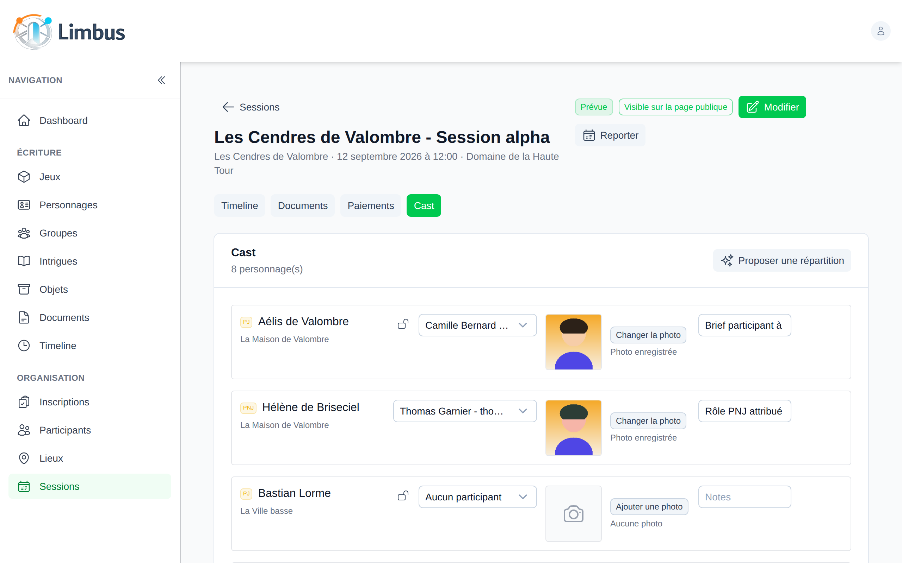
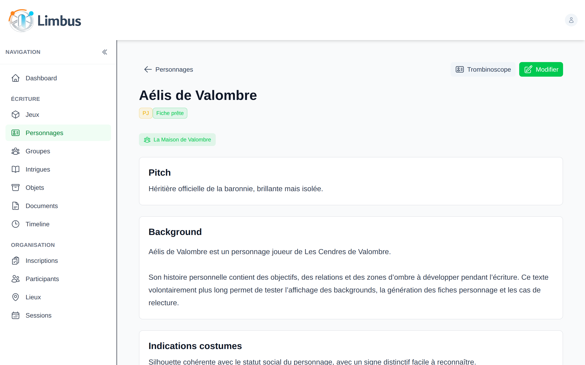
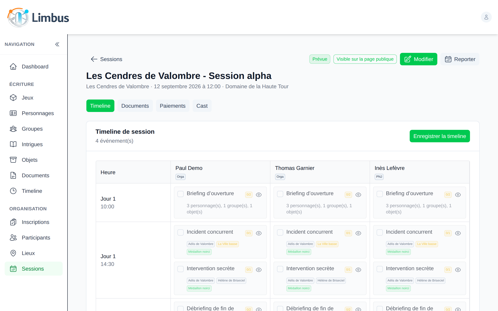
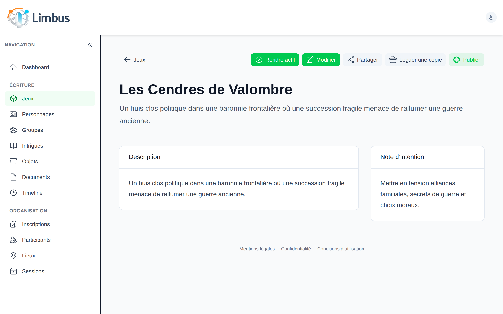

# Limbus

**L'outil des organisatrices et organisateurs de GN, de la première idée au débriefing.**

Limbus réunit en un seul endroit tout ce qu'on fait d'habitude entre un traitement de texte, trois tableurs et une boîte mail : écrire le jeu, inscrire les joueuses et joueurs, faire le casting, préparer les sessions et suivre les paiements.

En ligne sur **[limbuslarp.fr](https://limbuslarp.fr)**.



## Écrire le jeu

Personnages joueurs et non joueurs, groupes, intrigues, objets, documents, lieux et chronologie : chaque élément a sa fiche, reliée aux autres. On voit d'un coup d'œil qui est impliqué dans quelle intrigue, quels objets circulent, quelles relations lient les personnages.

- Une fiche se marque « prête à envoyer » quand elle est relue.
- Un jeu se partage avec des co-organisatrices, et se lègue en copie à une autre équipe qui veut le rejouer.
- Une page publique présente le jeu, ses sessions et son formulaire d'inscription.



## Inscrire et choisir

- Invitations personnelles ou formulaire public, avec les questions propres au jeu et les affinités (« je veux jouer avec », « je ne veux pas croiser »).
- Sélection à la main ou tirage au sort, avec son journal, liste d'attente par session, annonce groupée des décisions.
- Un assistant de casting propose une répartition des personnages d'après les réponses au questionnaire, sans mettre en relation deux personnes qui ne veulent pas jouer ensemble ni donner une relation que quelqu'un refuse. Les attributions verrouillées sont gardées.

## Préparer chaque session

- Le casting : qui joue qui, avec la photo de chacun pour son rôle.
- Les trombinoscopes et les fiches de personnage en PDF, envoyés par email à chaque personne, avec les documents qui la concernent.
- Les paiements : tarifs, versements, places offertes ou solidaires, et relance d'un clic de qui doit encore.
- La chronologie de déroulé, colonne par organisatrice ou PNJ, et la présence de l'équipe.
- Une session se reporte ou s'annule, et chacun est prévenu.



## Pour les joueuses et joueurs

Chaque personne a son espace « Je participe » : ses inscriptions, ses réponses, ses documents reçus. Ses coordonnées et ses allergies viennent de son compte, une seule fois pour tous les jeux.

## Et aussi

- **Hors ligne** : sur le terrain, sans réseau, l'application reste consultable ; les modifications partent au retour de la connexion.
- **Assistant d'IA** : on peut brancher son assistant (Claude, par exemple) sur les jeux de son choix pour écrire avec lui. Il ne voit ni les coordonnées ni les réponses libres des participants, et chacune de ses écritures est notée au journal.
- **Données personnelles** : export et effacement d'un participant ou d'un compte, photos retirables, durées de conservation limitées. Tout est décrit dans la [politique de confidentialité](https://limbuslarp.fr/confidentialite).



## Développer

Limbus est écrit avec Nuxt 4, Nuxt UI et PostgreSQL. Pour le lancer en local :

```bash
cp .env.example .env    # puis renseigner DATABASE_URL et JWT_SECRET
npm install
npx prisma migrate dev
npm run dev             # http://localhost:3000
```

Installation complète, tests et déploiement : [`doc/developpement.md`](doc/developpement.md). Chaque évolution passe par une spécification et ses décisions techniques, rassemblées dans [`doc/`](doc/README.md).

## Licence

[PolyForm Noncommercial 1.0.0](LICENSE) : le code est libre d'accès et d'usage non commercial (personnel, associatif, enseignement, recherche), mais toute utilisation commerciale est interdite. Les versions publiées avant le 2026-11-03 restent sous licence MIT pour qui les a déjà récupérées ([ADR-0060](doc/adr/ADR-0060-licence-non-commerciale.md)).
